# MHFA Connect 💚

chosen option C.  

### Mental Health First Aid, Support, and Resources for University Students

**MHFA Connect** is an AI-assisted mental health support and resource-navigation platform designed to help university students access mental health information, explore self-help resources, and discover appropriate support options.

The platform aims to make mental health resources more accessible, approachable, and culturally relevant, with a focus on university students and the Lesotho context.

MHFA Connect is designed to complement—not replace—qualified mental health professionals, counselling services, or emergency support.

---

## 📌 Table of Contents

- [About the Project](#-about-the-project)
- [Problem Statement](#-problem-statement)
- [Objectives](#-objectives)
- [Key Features](#-key-features)
- [Technology Stack](#-technology-stack)
- [Screenshots](#-screenshots)
- [Project Structure](#-project-structure)
- [Getting Started](#-getting-started)
- [Environment Configuration](#-environment-configuration)
- [Running the Application](#-running-the-application)
- [Language Support](#-language-support)
- [Privacy and Safety](#-privacy-and-safety)
- [Future Improvements](#-future-improvements)
- [Contributing](#-contributing)
- [Author](#-author)
- [Disclaimer](#-disclaimer)

---

## 🌿 About the Project

MHFA Connect was developed to explore how technology can help university students find mental health information and navigate available support resources.

The project combines a user-friendly web interface with AI-assisted support functionality and structured mental health resources. It emphasizes accessibility, privacy awareness, and the importance of connecting users with appropriate support.

The platform is informed by research into the availability, accessibility, and cultural relevance of Mental Health First Aid resources among university students.

### Our Vision

To make mental health information and support resources easier for university students to discover and access.

### Our Mission

To use technology responsibly to improve mental health awareness, encourage help-seeking, and connect students with relevant support options.

---

## 🎯 Problem Statement

University students may experience academic stress, burnout, anxiety, and other mental health challenges. However, finding relevant information and appropriate support can be difficult.

Barriers may include limited awareness of available resources, concerns about stigma, accessibility challenges, and a lack of culturally relevant information.

MHFA Connect explores how a digital platform can help address these challenges by bringing mental health information, self-help resources, AI-assisted guidance, and support-directory functionality into one place.

---

## 🎯 Objectives

The project aims to:

- Improve access to mental health information for university students.
- Provide self-help resources that encourage healthy coping strategies.
- Offer AI-assisted conversational support and resource navigation.
- Help users discover relevant mental health and peer-support options.
- Support English and Sesotho language experiences.
- Encourage appropriate help-seeking while communicating the limitations of AI-assisted support.
- Promote privacy-conscious use of digital mental health resources.

---

## ✨ Key Features

### 1. User Authentication

Users can create an account and log in to access protected areas of the application.

Authentication is handled through Supabase.

### 2. AI-Assisted Support Chat

The platform includes an AI-assisted chat experience designed to help users explore mental health information and identify relevant resources.

The chat is intended to provide supportive guidance, not clinical diagnosis or treatment.

### 3. Self-Help Resources

Users can explore structured self-help resources covering mental health and wellbeing topics.

These resources are intended to support awareness and encourage healthy coping strategies.

### 4. Peer Support

The platform presents peer-support options to help users explore supportive community resources.

Peer support is not a substitute for professional mental health care.

### 5. Support Directory

Users can explore available support resources and identify potential avenues for assistance.

The usefulness of this feature depends on the accuracy and availability of the listed resources.

### 6. English and Sesotho Language Support

The application includes a language selector for English and Sesotho, helping users navigate supported parts of the platform in their preferred language.

### 7. Account and Privacy Settings

The platform includes account-related options and privacy information to help users understand how to manage their account and consider the information they share.

### 8. Responsive User Interface

The interface uses responsive styling to support usability across different screen sizes.

### 9. User-Friendly Navigation

The application includes dedicated pages and navigation options for accessing its main features.

---

## 🛠️ Technology Stack

The following technologies are used in the project.

| Technology | Purpose |
|---|---|
| React | Building the user interface with reusable components |
| Vite | Frontend development server and build tooling |
| JavaScript | Application logic and interactivity |
| Tailwind CSS | Styling and responsive layouts |
| React Router | Client-side navigation between pages |
| Supabase | Authentication and backend services |
| Python / Flask | Backend API functionality for the AI-assisted support experience, where configured |
| Trained AI/ML Model | AI-assisted conversational functionality, where configured |
| Git and GitHub | Version control and project hosting |

---

## 📸 Screenshots

The screenshots below demonstrate the interface and major user journeys through MHFA Connect.

### 1. Landing Page

The landing page introduces MHFA Connect and helps users discover the platform's purpose and available options.

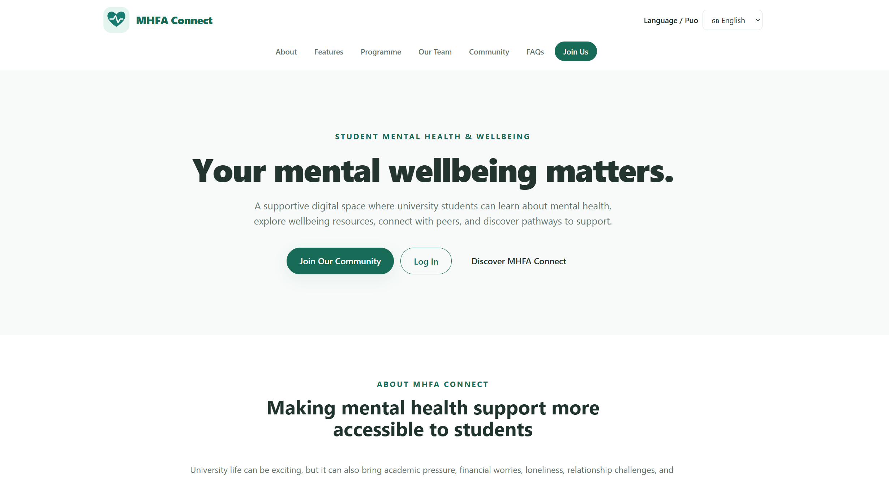

### 2. Registration Page

The registration page allows new users to create an account.

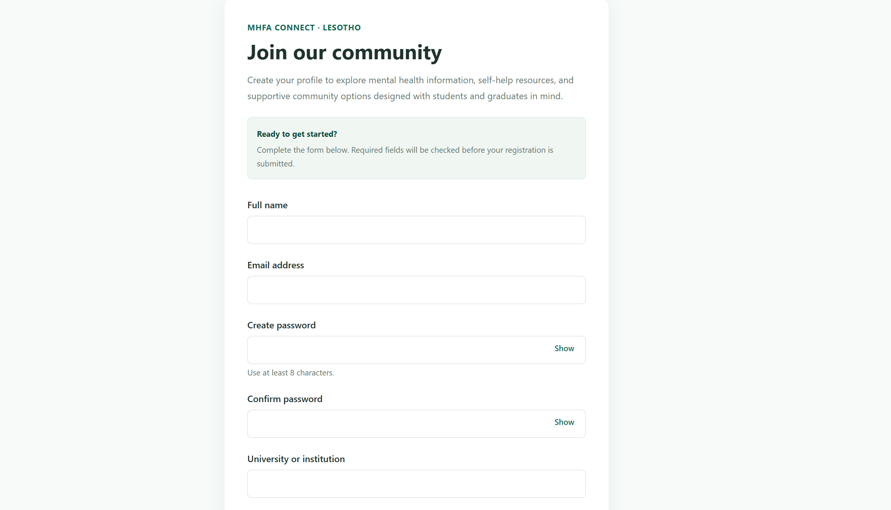

### 3. Login Page

The login page allows registered users to access their accounts.

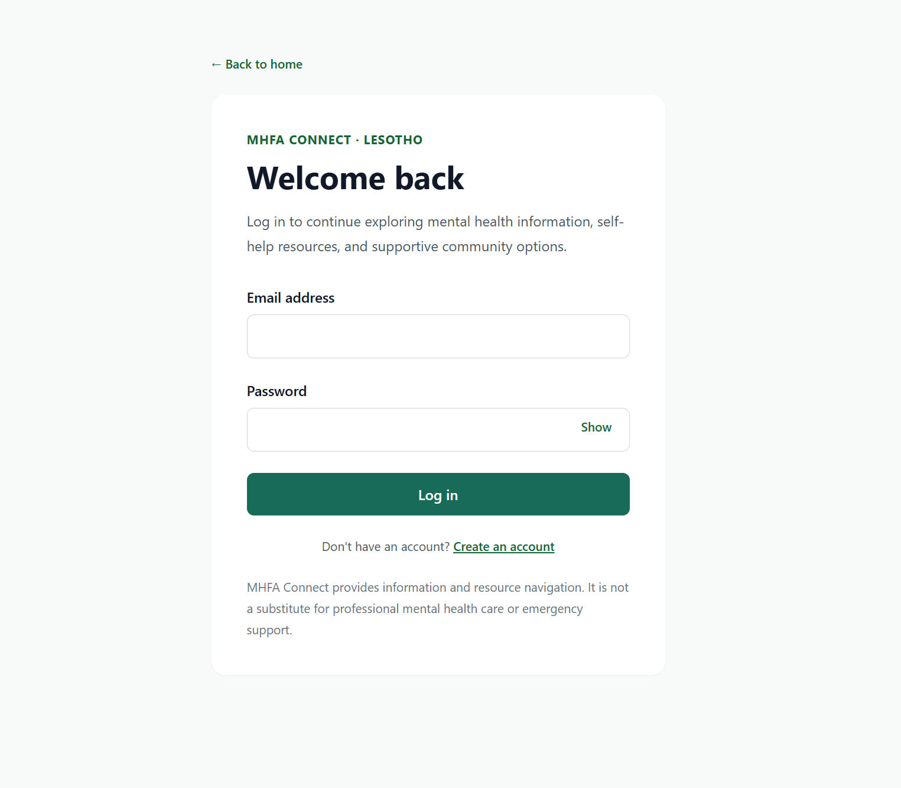

### 4. Main Application

The main application provides access to the platform's mental health information and support features.

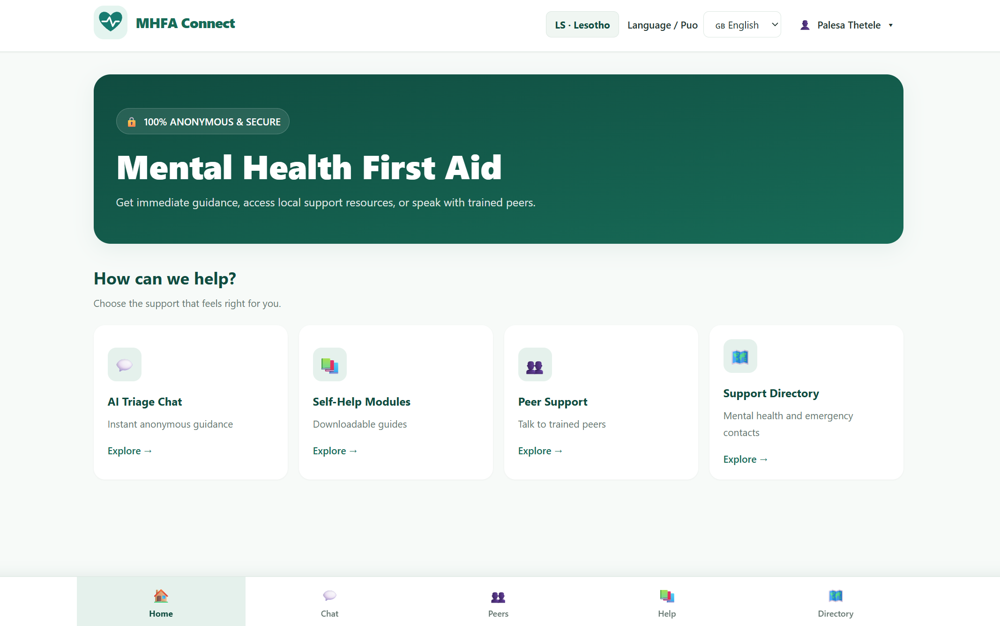

### 5. AI-Assisted Support Chat

The chat interface allows users to interact with the platform's AI-assisted support functionality.

### 6. Self-Help Resources

The self-help section provides access to structured mental health and wellbeing resources.

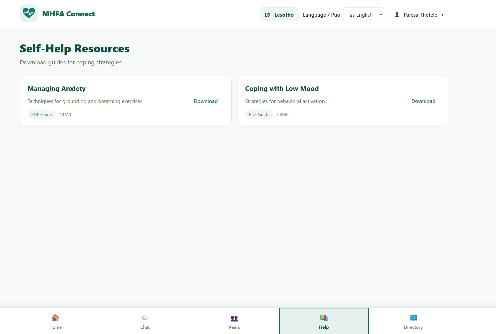

### 7. Directory

The directory section provides contact information for mental helf facilities 

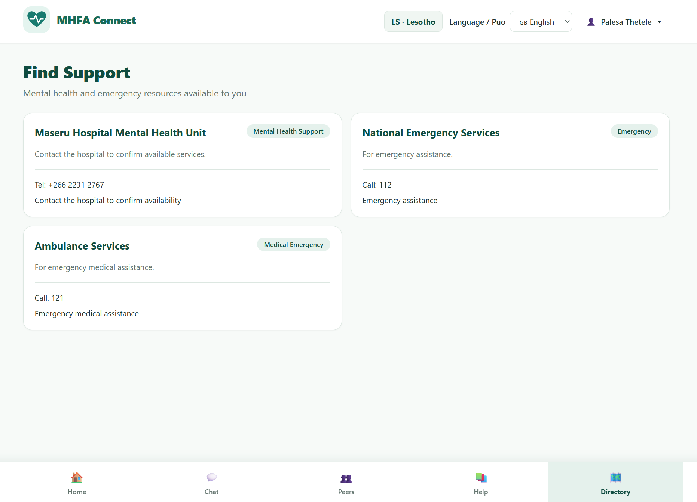

### 8. Language Support

The language selector allows users to choose between the supported English and Sesotho experiences.

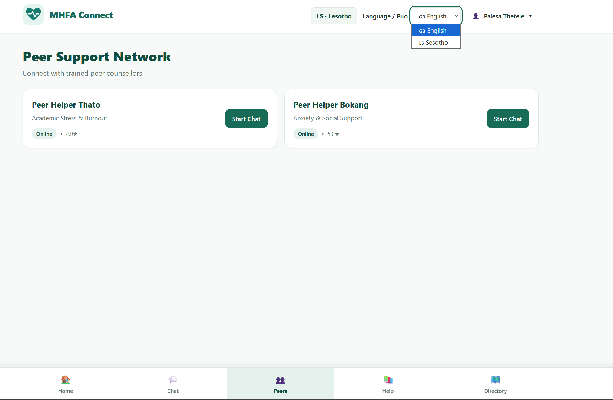

### 9. Account and Privacy Settings

The settings interface provides account-related options and privacy information.

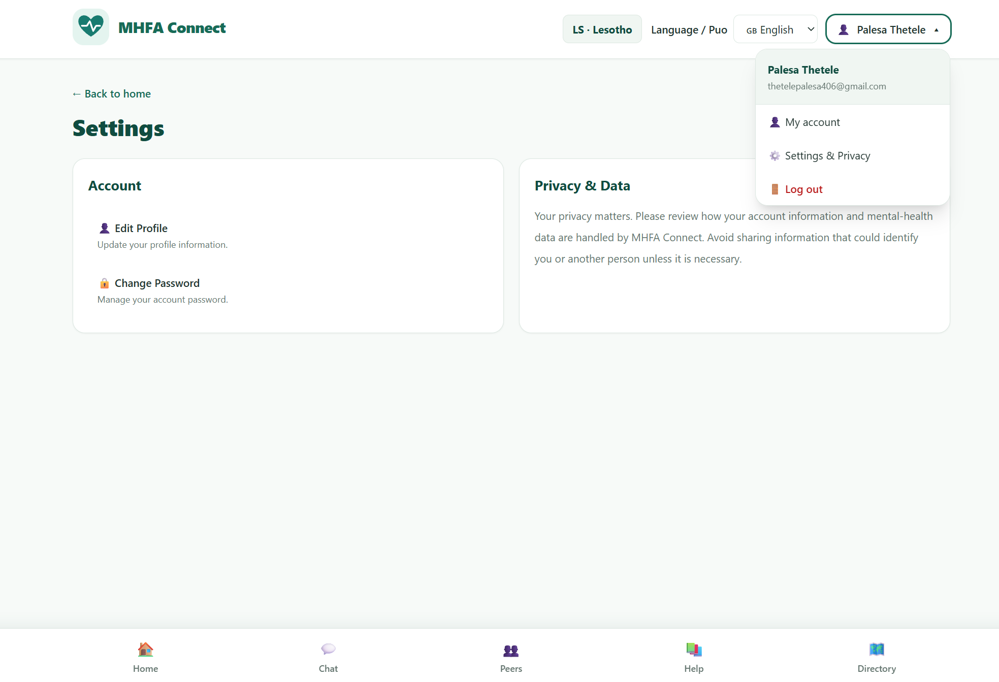

### 10. Responsive
The screenshots shows that the layout works at 375px (mobile), 768px (tablet) and 1280px (desktop) with no horizontal scrolling.

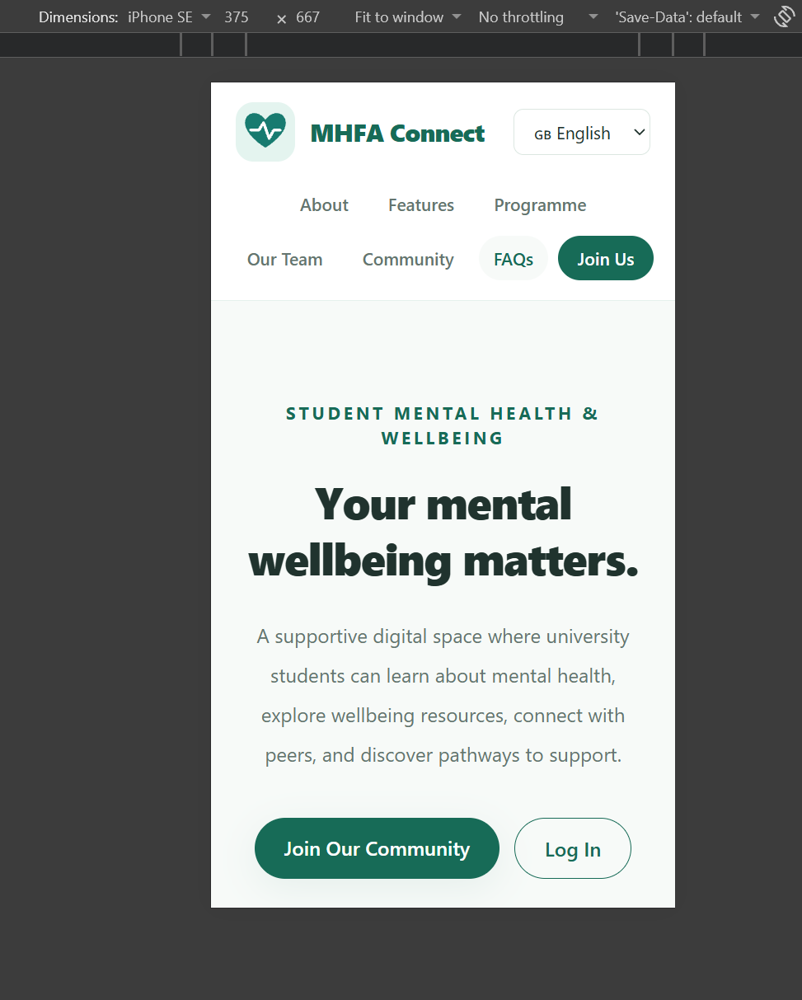
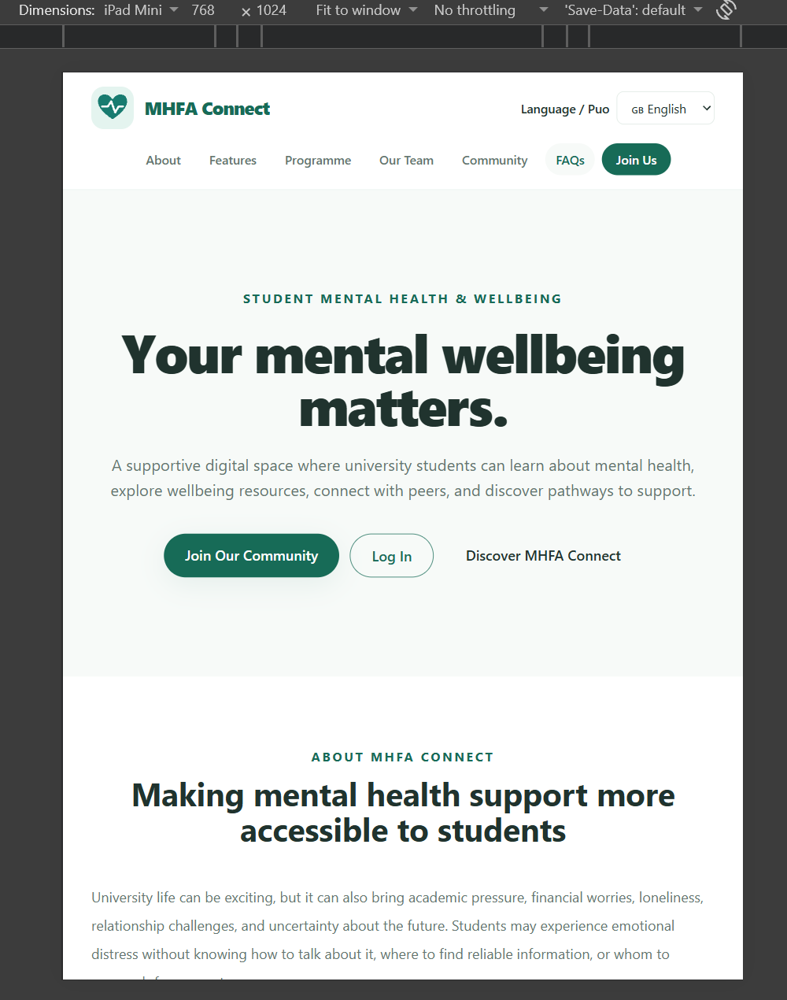
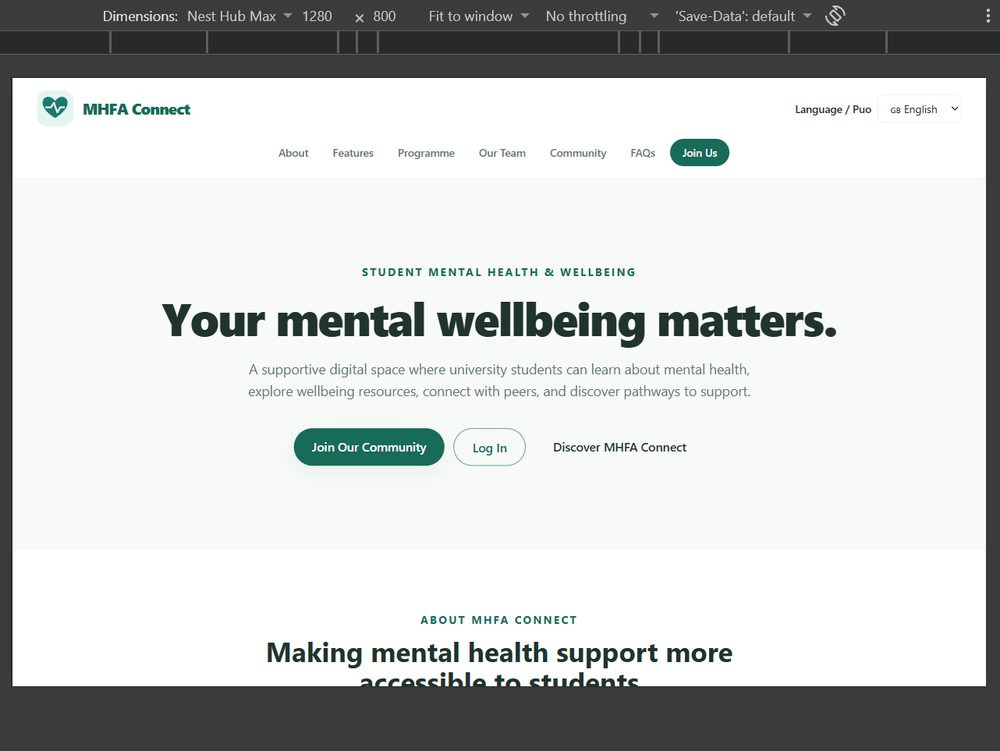

### 11. Lighthouse Score Before Performance Optimization (fixes)

The screenshot shows lighthouse audits performance score of performance, accessibility, best practices and seo before performance optimization. 

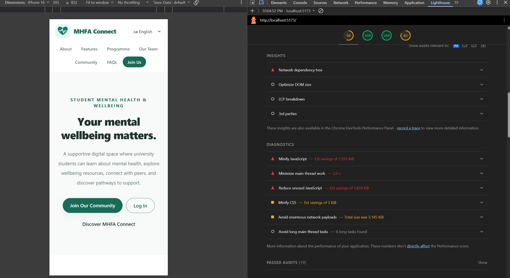

### 12. Lighthouse Score After Performance Optimization (fixes)

he screenshot shows lighthouse audits performance score of performance, accessibility, best practices and seo after performance optimization. 

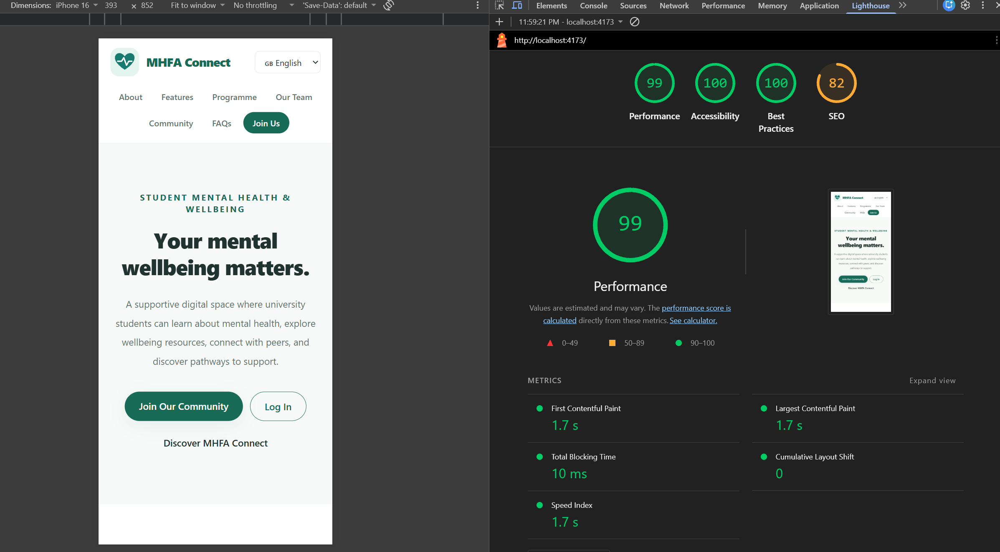
---

## Lighthouse Performance Analysis

Lighthouse audits were conducted using Chrome DevTools to evaluate MHFA Connect's performance, accessibility, best practices, and SEO.

### Performance Optimization Journey: From 56 to 99

The initial Lighthouse audit gave MHFA Connect a Performance score of 56/100. The report highlighted several areas affecting loading performance, including large JavaScript resources, unused JavaScript, excessive network payloads, and main-thread workload.

The Lighthouse recommendations guided the performance optimization process. A subsequent audit showed a significant improvement, with the Performance score increasing to 99/100.

Key improvements reflected in the audits included:

- Estimated unused JavaScript savings decreased from 1,434 KiB to 130 KiB.
- Estimated JavaScript minification savings decreased from 1,555 KiB to 16 KiB.
- First Contentful Paint improved from 10.3 seconds to 1.7 seconds.
- Largest Contentful Paint improved from 18.9 seconds to 1.7 seconds.
- Total Blocking Time decreased from 60 ms to 10 ms.
- Speed Index improved from 10.3 seconds to 1.7 seconds.

### Before-and-After Lighthouse Scores

| Category | Before | After |
| --- | ---: | ---: |
| Performance | 56 | 99 |
| Accessibility | 100 | 100 |
| Best Practices | 100 | 100 |
| SEO | 82 | 82 |

The Performance score improved by 43 points, representing approximately a 76.8% relative increase from the initial score.

### Final Performance Metrics

| Metric | Before | After |
| --- | ---: | ---: |
| First Contentful Paint | 10.3 s | 1.7 s |
| Largest Contentful Paint | 18.9 s | 1.7 s |
| Total Blocking Time | 60 ms | 10 ms |
| Cumulative Layout Shift | 0 | 0 |
| Speed Index | 10.3 s | 1.7 s |

### Remaining Optimization Opportunities

Although the final Performance score reached 99, Lighthouse continued to identify opportunities to reduce unused JavaScript and address render-blocking requests. These findings provide direction for further performance improvements.

Overall, the Lighthouse evaluation demonstrates a substantial improvement in MHFA Connect's loading speed and responsiveness while maintaining perfect Accessibility and Best Practices scores.

*Note: Lighthouse scores are laboratory measurements and may vary depending on testing conditions.*

## 📁 Project Structure

The following is an illustrative overview of the frontend structure. Your actual repository may contain additional folders and files.

MHFA-Connect/
├── public/
├── src/
│   ├── components/
│   ├── pages/
│   │   ├── JoinPage.jsx
        ├── LandingPage.jsx
│   │   ├── LoginPage.jsx
        ├── ProgrammePage.jsx
│   │   ├── ThankYouPage.jsx
│   │   └── NotFoundPage.jsx
│   ├── App.jsx
│   ├── LanguageContext.jsx
│   ├── constants.js
│   ├── main.jsx
    ├── supabaseClient.js
│   └── index.css
├── docs/
│   └── screenshots/
        ├── Landing-Page.png
│   │   ├── Login-Page.png
        ├── Registration-Page.png
│   │   ├── Dashboard.png
        ├── AI-Support-Chat.png
        ├── Self-Help-Resources.png
    │   ├── Language-Support.png
        ├── Account=Settings.png
        ├── Mobile-375px.png
        ├── Tablet-768px.png
        ├── Desktop-1280px.png
        ├── Lighthouse-Score-Before-Fixes.png
│   │   └── Lighthouse-Score-After-Fixes.png
├── .env.example
├── .gitignore
├── index.html
├── package.json
├── package-lock.json
├── vite.config.js
└── README.md

---

## 🚀 Getting Started

Follow these instructions to run the frontend locally.

### Prerequisites

Install the following:

- [Node.js](https://nodejs.org/) — use a version compatible with the project's Vite configuration.
- npm, which is included with Node.js.
- Git, if you want to clone the repository.
- A Supabase project and its required public project configuration for authentication features.

### 1. Clone the Repository

Replace the placeholder below with the actual URL of your GitHub repository.

git clone <https://github.com/PalesaThetele/MHFA-Connect-.git>

### 2. Navigate to the Project Folder

cd <MHFA--main>

### 3. Install Dependencies

npm install

### 4. Configure Environment Variables

Create a local `.env` file in the frontend project root and add the required configuration.

See [Environment Configuration](#-environment-configuration) below.

### 5. Start the Development Server

npm run dev

Vite will display the local development address in your terminal. Open that address in your browser.

The default address is commonly `http://localhost:5173/`, but use the address printed by your terminal.

### 6. Build for Production

To create a production build, run:

npm run build

To preview the production build locally, run:

npm run preview

These commands assume the corresponding scripts are present in `package.json`.

---

## 🔐 Environment Configuration

MHFA Connect uses external services that may require environment variables.

### Supabase Configuration

If the frontend uses the standard Vite environment variable names, your local `.env` file may contain:

VITE_SUPABASE_URL=your_supabase_project_url
VITE_SUPABASE_ANON_KEY=your_supabase_publishable_or_anon_key

Use the exact variable names expected by your existing Supabase client configuration. If your project uses different names, follow the names in that file instead.

### AI Backend Configuration

The AI support service uses a Flask backend and the Groq API, configure its required environment variables in the backend's own environment.

For example, Groq API key:

GROQ_API_KEY=your_groq_api_key

**Important security practices:**

- Do not commit `.env` files containing secrets.
- Do not expose private API keys in frontend code.
- Do not place a Groq API key in a `VITE_` variable, because Vite variables are exposed to client-side code.
- Keep backend secrets on the server.
- Share an `.env.example` containing placeholder values rather than real credentials.

---

## ▶️ Running the Application

For the frontend:

1. Install the Node.js dependencies.
2. Configure the required environment variables.
3. Start the Vite development server.
4. Open the local address displayed in the terminal.
5. Navigate through the landing page, registration, login, and available application features.

If the AI functionality depends on a separate backend, start that backend according to its own installation instructions.

Authentication and other integrations may not work correctly until their corresponding services have been configured.

---

## 🌍 Language Support

MHFA Connect supports English and Sesotho in the parts of the application that have been translated.

The language selector allows users to switch between supported language experiences.

Translations should be checked for clarity, cultural relevance, and consistency. Some third-party services, generated responses, or untranslated interface elements may remain in English.

---

## 🔒 Privacy and Safety

Mental health information can be sensitive. MHFA Connect is designed with privacy awareness and responsible use in mind.

Users should avoid sharing unnecessary personally identifiable or sensitive information.

The platform is not a substitute for:

- Professional mental health assessment or treatment.
- Qualified counselling services.
- Emergency services or crisis intervention.

AI-generated responses may be incomplete or inaccurate. Users should seek qualified help when dealing with serious or urgent mental health concerns.

The project's privacy and safety claims should reflect the protections actually implemented in the application and its connected services.

---

## 🚧 Future Improvements

Potential areas for further development include:

- Expanding and validating the directory of mental health support resources.
- Improving the cultural relevance and quality of English and Sesotho content.
- Strengthening safety testing for the AI-assisted chat.
- Improving accessibility and usability across devices.
- Expanding user testing and evaluating the usefulness of the platform.
- Improving performance and reducing unnecessary frontend JavaScript.
- Developing clearer deployment and maintenance documentation.
- Activate/ fully implement all backend functionalities, including AI-Assistance responses
- Create fully functioning user profile, where the user can edit their profile details, including changing thier password and others.
- Include a "forgot passwords" functionality on the login page and add login options like continue/signin with google account features.

---

## 🤝 Contributing

Contributions that improve accessibility, usability, documentation, translations, and responsible mental health resource navigation are welcome.

To propose a change:

1. Fork the repository.
2. Create a branch for your change.
3. Make and test your changes.
4. Submit a pull request describing what you changed and why.

---

## 👩🏽‍💻 Author

**Palesa Emily Thetele**

Junior Computer Scientist | Software Development | AI for Social Impact

MHFA Connect reflects an interest in using technology to improve access to mental health information and support resources.

---

## ⚠️ Disclaimer

MHFA Connect is an educational and support-navigation project. It does not provide a clinical diagnosis, replace professional mental health care, or guarantee the accuracy of AI-generated information.

Users experiencing a mental health emergency should contact appropriate local emergency services or a qualified professional.

---

**MHFA Connect — Your mental wellbeing matters. 💚**